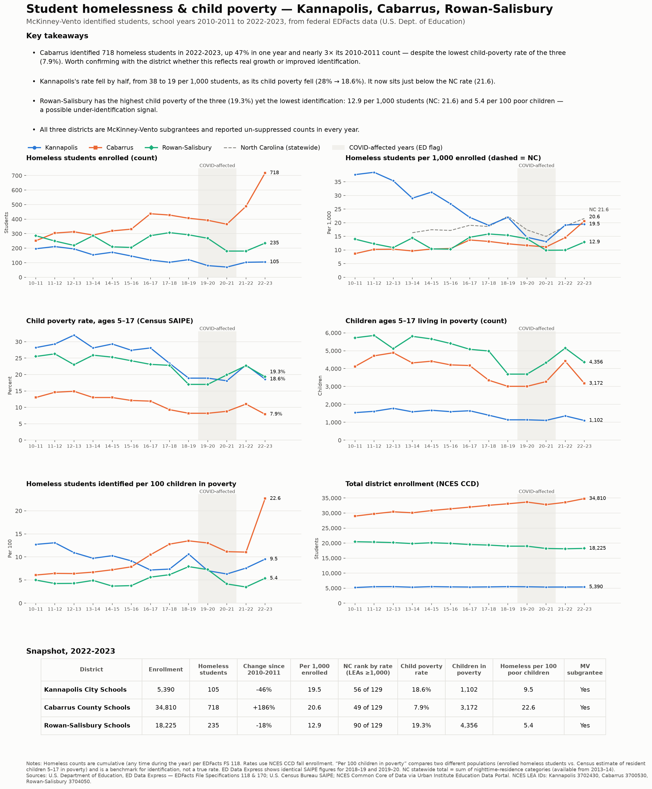

# McKinney-Vento data: Kannapolis, Cabarrus, Rowan-Salisbury

Pulls federal homeless-student counts (McKinney-Vento) for North Carolina school districts and sets up analysis and charts.



To regenerate the one-page report, run `python3 report.py`.

## Quick start

```bash
python3 -m pip install -r requirements.txt   # pandas, matplotlib, requests, python-dotenv
cp .env.example .env                         # optional: override paths, districts, etc.
python3 -m mckinney_vento.pull               # downloads → data/processed/*.csv (cached in data/raw/)
python3 analysis.py                          # tables + charts → figures/
```

Settings live in `.env`, which is git-ignored. See `.env.example` for the options: `MV_DISTRICTS`, `MV_DATA_DIR`, `MV_FIGURES_DIR`, `MV_REQUEST_PAUSE_SEC`, and `MV_USER_AGENT`.

`analysis.py` uses `# %%` cells, so it opens as a notebook in VS Code or Jupyter.

## Sources

| Data | Source | Notes |
|---|---|---|
| Homeless students enrolled, by LEA | **ED Data Express** (U.S. Dept. of Education), EDFacts **FS 118** | 2010-11 → latest; every NC LEA |
| McKinney-Vento subgrant status | EDFacts FS 170 (same endpoint) | |
| Children 5–17 in poverty, SAIPE rate | U.S. Census SAIPE (same endpoint) | |
| Statewide counts by nighttime residence | ED Data Express | **State level only.** The API does not expose district breakdowns |
| District enrollment (rate denominator) | NCES Common Core of Data, via Urban Institute Education Data API | `year` = fall of school year |

ED Data Express has no documented API. The client in `mckinney_vento/edx.py` uses the JSON endpoints behind the dashboard: `/api/v2/{dataset}/{viz}?sy=&s=`. It finds each year's IDs from the dashboard page. When the site changes, that file is the place to fix.

## Outputs (`data/processed/`)

- `north_carolina_lea_homeless.csv`: every NC LEA × year. `homeless_status` is `reported`, `suppressed` (small cell), or `not_available`.
- `north_carolina_lea_enrollment.csv`: CCD enrollment by LEA × year.
- `north_carolina_state_residence.csv`: statewide counts by primary nighttime residence.

`mckinney_vento.load` builds analysis frames:
- `focus_panel()`: the three districts.
- `statewide_panel()`: all NC LEAs, for peer comparisons.
- `state_totals()`: NC totals.

The derived metrics are `homeless_per_1000_enrolled`, `homeless_per_100_poor_children`, and `covid_affected`.

## Caveats

- 2019-20 and 2020-21 are flagged by ED as COVID-affected; identification dropped because students were remote.
- Counts are cumulative: a student is counted if they were homeless and enrolled at any point in the year.
- Federal data lags about 2 years. NC DPI may have newer figures, but those are not the federal record.
- To change the target districts, set `MV_DISTRICTS` in `.env`, or edit the defaults in `mckinney_vento/config.py`. Both use 7-digit NCES LEA IDs.
